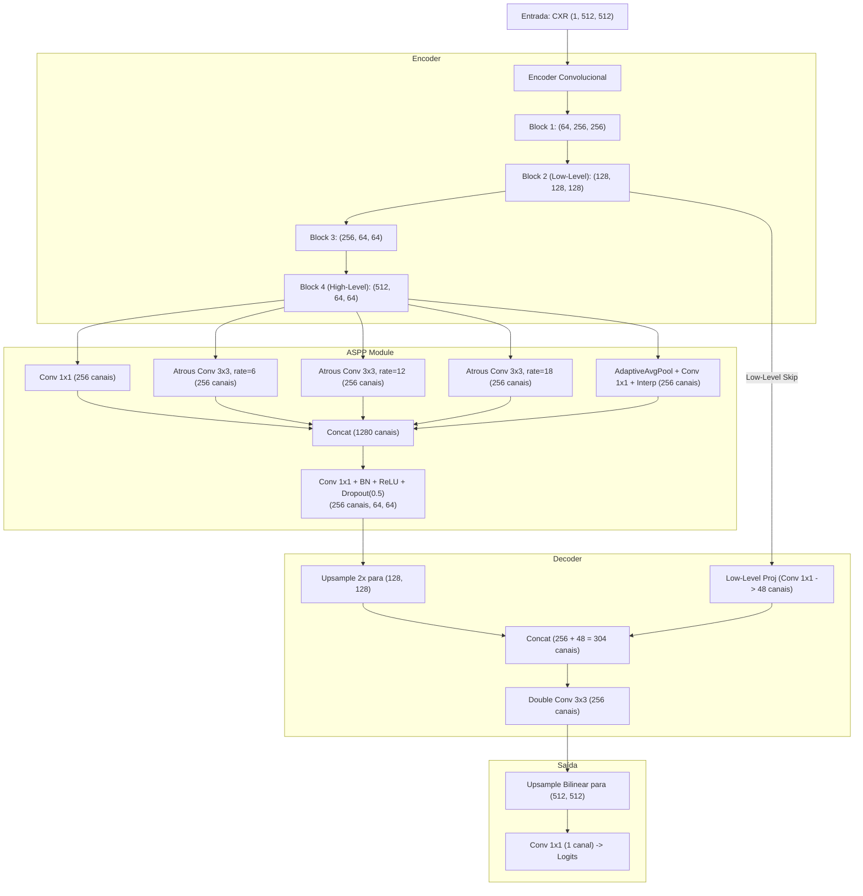

# Módulo 07: DeepLabv3+ (Atrous Convolutions e ASPP)

Arquivos relacionados:
- Arquitetura: [`models/deeplabv3_plus.py`](/models/deeplabv3_plus.py)
- Treinamento: [`train_deeplabv3_plus.py`](/train_deeplabv3_plus.py)
- Avaliação: [`evaluate_deeplabv3_plus.py`](/evaluate_deeplabv3_plus.py)

---

## 1. Contexto Teórico e Motivação

Desenvolvida pelo Google Research (Chen et al., ECCV 2018), a família DeepLab introduziu soluções matemáticas inovadoras para dois problemas fundamentais da segmentação semântica:
1. **Perda de Resolução Espacial por Subamostragem**: Operações sucessivas de pooling e stride reduzem a resolução do mapa de ativações, tornando difícil a recuperação precisa de contornos.
2. **Variabilidade de Escala dos Objetos**: Em radiografias, os pulmões podem ter volumes amplos, mas detalhes patológicos e contornos periféricos exigem campos de visão em múltiplas resoluções espaciais simultâneas.

### As Duas Grandes Inovações do DeepLabv3+
- **Convolução Dilatada (*Atrous Convolution*)**: Permite expandir o campo receptivo do kernel sem aumentar o número de parâmetros e sem reduzir a resolução espacial.
- **Atrous Spatial Pyramid Pooling (ASPP)**: Captura contexto multiescala através de múltiplos ramos convolucionais com taxas de dilatação distintas operando em paralelo, combinados com *pooling* global de imagem.
- **Decodificador Refinado (*Encoder-Decoder com Low-Level Fusion*)**: Funde as características ricas em contexto do ASPP com características espaciais detalhadas de baixo nível projetadas por uma convolução $1 \times 1$.

---

## 2. Fundamentos da Convolução Dilatada (*Atrous Convolution*)

Para um sinal bidimensional $x$, a convolução dilatada com taxa $r$ (*dilation rate*) é dada por:

$$y[i, j] = \sum_{k=1}^K \sum_{l=1}^L x[i + r \cdot k, j + r \cdot l] \cdot w[k, l]$$

- Se $r = 1$: Convolução padrão de kernel $3 \times 3$, com campo receptivo de $3 \times 3$.
- Se $r = 6$: Insere $5$ "espaços vazios" (zeros) entre os pesos do filtro. O kernel $3 \times 3$ passa a enxergar uma região de $13 \times 13$ pixels na imagem sem adicionar nenhum parâmetro extra à rede.
- Se $r = 12$: O campo receptivo passa a ser de $25 \times 25$ pixels.
- Se $r = 18$: O campo receptivo abrange $37 \times 37$ pixels.

---

## 3. Diagrama da Arquitetura: [`DeepLabV3Plus`](/models/deeplabv3_plus.py#L208-L245)



---

## 4. Análise dos Módulos em Código

### 4.1. Módulo ASPP: [`ASPP`](/models/deeplabv3_plus.py#L5-L98)
O módulo recebe os 512 canais da camada mais profunda do codificador e processa em 5 ramos paralelos:
1. Convolução pontual $1 \times 1$: Mantém o contexto local refinado.
2. Três convoluções atrous $3 \times 3$ com taxas de dilatação $r \in \{6, 12, 18\}$ e preenchimento compatível ($p = r$).
3. Ramo de Pooling Global (`AdaptiveAvgPool2d(1)`): Calcula a média global de cada canal em toda a imagem, captura o contexto semântico global do tórax e faz upsampling bilinear para a dimensão de entrada.
4. Concatena os $5 \times 256 = 1280$ canais e projeta para 256 canais via convolução $1 \times 1$ com `Dropout(0.5)`.

### 4.2. Decodificador com Projeção de Baixo Nível: [`Decoder`](/models/deeplabv3_plus.py#L153-L207)
Um erro comum ao fundir características de baixo nível é deixar que elas dominem a representação semântica rica do ASPP. O DeepLabv3+ resolve isso projetando as características de baixo nível (`block2`, 128 canais) para apenas **48 canais** através de convolução $1 \times 1$:
```python
self.low_level_projection = nn.Sequential(
    nn.Conv2d(128, 48, kernel_size=1, bias=False),
    nn.BatchNorm2d(48),
    nn.ReLU(inplace=True)
)
```
Em seguida, o mapa do ASPP é superamostrado para a mesma resolução espacial e concatenado ($256 + 48 = 304$ canais), passando por duas convoluções $3 \times 3$ que refinam os detalhes de borda dos pulmões.

---

## 5. Treinamento e Avaliação

### Treinamento: [`train_deeplabv3_plus.py`](/train_deeplabv3_plus.py)
- **Função de Custo**: `bce_loss + dice_loss`.
- **Otimizador**: Adam ($\eta = 10^{-3}$).
- **Batch Size**: 8.
- **Épocas**: 15 épocas.
- **Salvamento**: Checkpoint com menor `val_loss` gravado em `DeepLabV3Plus_best_bce_dice_aug.pth`.

### Avaliação: [`evaluate_deeplabv3_plus.py`](/evaluate_deeplabv3_plus.py)
- Avaliação sobre [`trained_models/DeepLabV3Plus_best_bce_dice_aug.pth`](/trained_models/DeepLabV3Plus_best_bce_dice_aug.pth).
- O ASPP se destaca especialmente ao lidar com pulmões de tamanhos atípicos (por exemplo, hiperinsuflação enfisematosa ou colapso atelectásico), graças à sua robustez multiescala.
