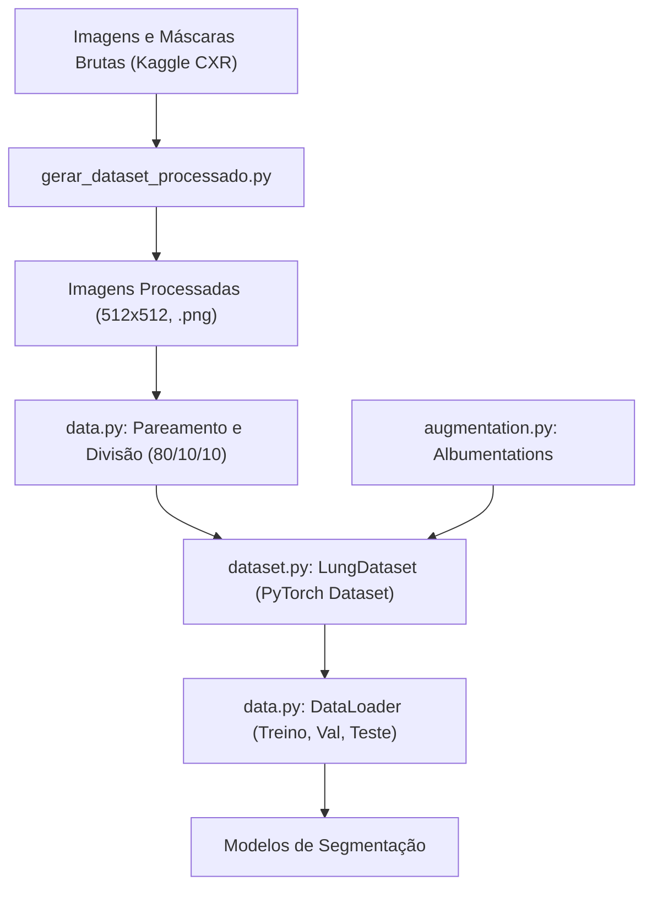

# Módulo 01: Pré-Processamento, Pipeline de Dados e Data Augmentation

Este documento detalha o fluxo de engenharia de dados implementado no projeto para carregar, processar, aumentar e disponibilizar as imagens de raios-X de tórax (CXR) e suas respectivas máscaras pulmonares para o treinamento dos modelos de aprendizado profundo.

---

## 1. Visão Geral do Pipeline de Dados

O fluxo de dados é estruturado em três etapas principais:



---

## 2. Pré-processamento Offline: [`gerar_dataset_processado.py`](/gerar_dataset_processado.py)

O script [`gerar_dataset_processado.py`](/gerar_dataset_processado.py) é responsável por preparar os dados brutos oriundos do [Kaggle Lung Segmentation Dataset](https://www.kaggle.com/code/nikhilpandey360/lung-segmentation-from-chest-x-ray-dataset).

### 2.1. Métodos e Lógica Implementada

#### 1. Mapeamento e Pareamento de Arquivos
- **Problema**: No dataset original, as máscaras de segmentação frequentemente possuem o sufixo `_mask` em seu nome de arquivo (por exemplo, `CHNCXR_0001_0_mask.png`), enquanto a radiografia correspondente chama-se `CHNCXR_0001_0.png`. Algumas outras máscaras já compartilham o mesmo nome exato.
- **Implementação**:
  - Constrói-se um dicionário `mask_dict` mapeando o identificador base da imagem para o caminho do arquivo de máscara correspondente:
    ```python
    if mask_name.endswith('_mask'):
        image_name = mask_name[:-5]
    else:
        image_name = mask_name
    mask_dict[image_name] = mask_path
    ```
  - Itera-se sobre `all_images` e, caso o stem da imagem exista no dicionário de máscaras, cria-se a tupla pareada `(img_path, mask_path)`. Imagens sem máscara correspondente são isoladas em `missing_masks`.

#### 2. Função [`preprocessing_and_save`](/gerar_dataset_processado.py#L24-L49)
```python
def preprocessing_and_save(img_path, mask_path, out_img_dir, out_mask_dir, img_size=(512, 512)):
```
- **Carregamento em escala de cinza**: Ambas as imagens e máscaras são lidas através de `cv2.imread(..., cv2.IMREAD_GRAYSCALE)`.
- **Redimensionamento padronizado para 512x512**:
  - Imagem radiográfica: Utiliza interpolação `cv2.INTER_AREA`, ideal para redução de resolução (downsampling) por preservar detalhes de bordas e texturas sem criar artefatos de serrilhado.
  - Máscara de segmentação: Utiliza interpolação `cv2.INTER_NEAREST` (vizinho mais próximo), fundamental para garantir que não ocorra interpolação contínua de valores intermediários nas fronteiras da máscara.
- **Binarização estrita da máscara**:
  - Executa-se `mask = (mask > 0).astype('uint8') * 255`. Isso elimina ruídos de digitalização e assegura que os pixels pertençam estritamente ao fundo (0) ou aos pulmões (255).
- **Salvamento em disco**: Imagens e máscaras redimensionadas são persistidas em diretórios dedicados (`Processed Lung Segmentation/images` e `Processed Lung Segmentation/masks`).

#### 3. Função de Visualização [`show_sample`](/gerar_dataset_processado.py#L125-L157)
- Exibe lado a lado: a radiografia, a máscara binária e a sobreposição (overlay) colorida da máscara sobre o raio-X com transparência ($\alpha = 0.3$), permitindo inspeção visual da qualidade do alinhamento anatômico.

---

## 3. Dataset em PyTorch: [`dataset.py`](/dataset.py)

O arquivo [`dataset.py`](/dataset.py) define a classe [`LungDataset`](/dataset.py#L9-L92), herdada de `torch.utils.data.Dataset`.

### 3.1. Estrutura da Classe [`LungDataset`](/dataset.py#L9-L92)

- **`__init__(self, pairs, transform=None)`**: Recebe a lista de tuplas com os caminhos `(caminho_imagem, caminho_mascara)` e um pipeline opcional de transformações do Albumentations.
- **`__len__(self)`**: Retorna a quantidade total de pares no split.
- **`__getitem__(self, idx)`**: Executa o pipeline dinâmico para uma amostra:
  1. **Leitura das imagens**: Leitura via OpenCV em monocromático (`cv2.IMREAD_GRAYSCALE`).
  2. **Aplicação de Augmentations**: Caso `self.transform` esteja configurado, aplica transformações simultaneamente na imagem e na máscara:
     ```python
     transformed = self.transform(image=image, mask=mask)
     image = transformed["image"]
     mask = transformed["mask"]
     ```
  3. **Normalização dos Tensores**:
     - Radiografia: Conversão para ponto flutuante de precisão simples e divisão por 255.0, resultando no intervalo $[0.0, 1.0]$:
       $$\text{image}_{\text{norm}} = \frac{\text{image}}{255.0}$$
     - Máscara: Binarização booleana convertida para ponto flutuante ($0.0$ para fundo, $1.0$ para pulmão):
       $$\text{mask}_{\text{bin}} \in \{0.0, 1.0\}$$
  4. **Adição da dimensão de canal**:
     - O PyTorch adota o padrão `(C, H, W)`. Como as imagens são monocromáticas, adiciona-se o canal unitário via `np.expand_dims(..., axis=0)`, resultando na dimensionalidade `(1, 512, 512)`.
  5. **Conversão para `torch.Tensor`**: Retorna os tensores prontos para o `DataLoader`.

---

## 4. Divisão e Criação de Dataloaders: [`data.py`](/data.py)

O arquivo [`data.py`](/data.py) encapsula a estratégia de particionamento e geração de lotes (batches).

### 4.1. Funções Implementadas

#### 1. [`get_image_mask_pairs`](/data.py#L9-L29)
- Localiza todos os arquivos `.png` no diretório de imagens processadas e verifica a existência de um arquivo homônimo no diretório de máscaras.
- Retorna a lista completa de pares validados.

#### 2. [`create_datasets`](/data.py#L32-L90)
Realiza a divisão estratificada temporal em dois estágios para evitar vazamento de dados (*data leakage*):
1. **Primeira Divisão**: Separa o conjunto de treino do conjunto temporário (validação + teste):
   - Proporção: `test_size + val_size` (padrão: $0.10 + 0.10 = 0.20$, ou seja, 80% treino e 20% temporário).
2. **Segunda Divisão**: Divide o conjunto temporário igualmente entre validação e teste:
   - `relative_test_size = test_size / (test_size + val_size)` ($0.10 / 0.20 = 0.50$, resultando em 10% para validação e 10% para teste do total original).
3. **Reprodutibilidade**: Ambas as divisões utilizam a mesma semente (`random_state=42`).
4. **Instanciação**: Constrói três instâncias de [`LungDataset`](/dataset.py#L9-L92), injetando transformações de aumento de dados exclusivamente no conjunto de treino (`train_transform`).

#### 3. [`create_dataloaders`](/data.py#L92-L125)
- Cria os iteradores `torch.utils.data.DataLoader`:
  - `train_loader`: `shuffle=True` (embaralhamento a cada época para estocasticidade do gradiente).
  - `val_loader` e `test_loader`: `shuffle=False` (ordenação determinística para validação consistente).
  - Padrão de `batch_size=8` e `num_workers=0` (compatível com Windows sem concorrência de subprocessos).

---

## 5. Estratégia de Aumento de Dados: [`augmentation.py`](/augmentation.py)

Em imagens médicas, o aumento de dados deve respeitar a anatomia humana. O módulo [`augmentation.py`](/augmentation.py) adota transformações geometricamente plausíveis através da biblioteca `albumentations`:

```python
def get_train_augmentation():
    return A.Compose([
        A.HorizontalFlip(p=0.5),
        A.Affine(
            scale=(0.9, 1.1),
            translate_percent=(-0.1, 0.1),
            rotate=(-8, 8),
            p=0.5
        )
    ])
```

### 5.1. Justificativa Didática das Transformações
1. **`HorizontalFlip(p=0.5)`**:
   - Inverte horizontalmente o tórax. Embora órgãos mediastinais como o coração sejam assimétricos, os campos pleuropulmonares direito e esquerdo guardam simetria funcional para o aprendizado de segmentação de contorno pulmonar.
2. **`Affine(scale=(0.9, 1.1), translate_percent=(-0.1, 0.1), rotate=(-8, 8))`**:
   - **Escala ($0.9$ a $1.1$)**: Simula variações na distância foco-filme e na capacidade inspiratória do paciente (volumes pulmonares variáveis).
   - **Translação ($\pm 10\%$)**: Simula pequenos erros de centralização do paciente no chassi radiográfico.
   - **Rotação ($\pm 8^\circ$)**: Simula pequenas rotações posturais do paciente durante a incidência póstero-anterior (PA) ou ântero-posterior (AP). Rotações maiores que $\pm 10^\circ$ seriam clinicamente atípicas e prejudicariam a anatomia esperada.
3. **`get_val_test_augmentation()`**:
   - Retorna um `A.Compose([])` vazio. Não se aplica aumento sintético nos conjuntos de validação e teste para avaliar os modelos sob condições fidedignas da distribuição real.

---

## 6. Inspeção Visual das Amostras: [`testes.py`](/testes.py)

O script [`testes.py`](/testes.py) atua como ferramenta de validação e depuração do pipeline de aumento de dados.

### 6.1. Funcionamento
1. Carrega uma imagem e máscara de teste: `CHNCXR_0001_0.png`.
2. Imprime no console metadados de inspeção (dimensões, valores mínimo, máximo e valores únicos da máscara).
3. Executa $N=6$ vezes o pipeline `get_train_augmentation()`.
4. Plota uma matriz gráfica de $6 \times 4$ com:
   - Coluna 1: Imagem original.
   - Coluna 2: Máscara original.
   - Coluna 3: Imagem aumentada com sobreposição semitransparente da máscara transformada ($\alpha = 0.35$).
   - Coluna 4: Máscara aumentada isolada.
5. Permite ao pesquisador confirmar visualmente se a máscara sofreu exatamente as mesmas transformações afins que a imagem radiográfica correspondente, evitando dessincronização espacial.
