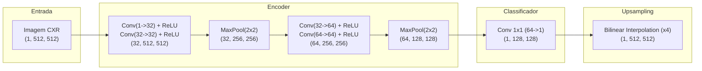

# Módulo 03: Fully Convolutional Network (FCN)

Arquivos relacionados:
- Arquitetura: [`models/fcn.py`](/models/fcn.py)
- Treinamento: [`train_fcn.py`](/train_fcn.py)
- Avaliação: [`evaluate_fcn.py`](/evaluate_fcn.py)

---

## 1. Contexto Teórico e Histórico

A **Fully Convolutional Network (FCN)**, proposta originalmente por Long, Shelhamer e Darrell (CVPR 2015), foi um marco histórico na visão computacional. Antes da FCN, as redes neurais convolucionais (CNNs como AlexNet e VGG) terminavam com camadas totalmente conectadas (*fully connected layers*), o que as limitava a prever um único rótulo para toda a imagem (classificação global).

A grande inovação da FCN foi:
1. **Substituir camadas totalmente conectadas por convoluções $1 \times 1$**: Permite que a rede processe entradas de qualquer tamanho espacial e gere mapas de características em vez de um único vetor numérico.
2. **Classificação densa pixel a pixel**: Cada posição espacial no mapa de saída corresponde à predição de classe para uma região na imagem original.
3. **Superamostragem (*Upsampling*)**: Utilização de interpolação bilinear ou transposta para restaurar o mapa de predições de baixa resolução para a dimensão espacial original.

---

## 2. Diagrama da Arquitetura Implementada: [`SimpleFCN`](/models/fcn.py#L5-L55)



---

## 3. Análise Detalhada dos Componentes

### 3.1. Codificador Convolucional (*Encoder*)
O bloco codificador é composto por 4 camadas de convolução $3 \times 3$ com preenchimento (*padding=1*) e 2 operações de redução espacial (*max pooling*):

```python
self.encoder = nn.Sequential(
    nn.Conv2d(1, 32, kernel_size=3, padding=1),
    nn.ReLU(inplace=True),
    nn.Conv2d(32, 32, kernel_size=3, padding=1),
    nn.ReLU(inplace=True),
    nn.MaxPool2d(kernel_size=2),  # 512x512 -> 256x256

    nn.Conv2d(32, 64, kernel_size=3, padding=1),
    nn.ReLU(inplace=True),
    nn.Conv2d(64, 64, kernel_size=3, padding=1),
    nn.ReLU(inplace=True),
    nn.MaxPool2d(kernel_size=2),  # 256x256 -> 128x128
)
```

- **Fator de Redução Espacial**: Dois *max poolings* com stride 2 reduzem a imagem de $512 \times 512$ para $128 \times 128$ (redução de $4\times$ em cada eixo espacial).
- **Extração Semântica**: As primeiras camadas detectam bordas de contraste nos contornos do tórax e costelas. As camadas seguintes agrupam esses elementos em representações de textura tecidual pulmonar.

### 3.2. Projeção de Canal (*Classificador $1 \times 1$*)
```python
self.classifier = nn.Conv2d(in_channels=64, out_channels=1, kernel_size=1)
```
- A convolução $1 \times 1$ atua como uma combinação linear sobre a profundidade de 64 canais para cada coordenada espacial $(h, w)$, gerando um único mapa de *logits* de dimensão $(B, 1, 128, 128)$.

### 3.3. Reconstrução Espacial (*Upsampling Bilinear*)
```python
x = F.interpolate(x, scale_factor=4, mode='bilinear', align_corners=False)
```
- A rede amplia o mapa de predição em $4\times$ através de interpolação bilinear contínua, restaurando o mapa para $(B, 1, 512, 512)$.

---

## 4. Treinamento e Configurações: [`train_fcn.py`](/train_fcn.py)

- **Otimizador**: Adam com taxa de aprendizado $\eta = 10^{-3}$.
- **Função de Perda**: `nn.BCEWithLogitsLoss()`.
- **Tamanho de Lote (Batch Size)**: 8.
- **Épocas**: 10 épocas.
- **Melhor Modelo**: Monitora a perda de validação (`val_loss`) e salva os pesos com menor erro em `fcn_best_bce_dice_aug.pth` / `fcn_best_aug.pth`.

---

## 5. Pontos Fortes e Limitações Didáticas da FCN

### Pontos Fortes
- **Leveza e Simplicidade**: Possui poucos parâmetros (cerca de $66.000$ parâmetros), treinando rapidamente mesmo em GPUs mais modestas ou em CPU.
- **Excelente Baseline Didático**: Permite entender a transição da classificação de imagens tradicional para a classificação densa de pixels.

### Limitações
- **Ausência de Conexões de Salto (*Skip Connections*)**: Ao reduzir a imagem para $128 \times 128$ e aplicar uma interpolação direta de $4\times$, os detalhes de alta frequência espacial (como os ângulos costofrênicos e apicais dos pulmões) são perdidos irreversivelmente. O resultado tende a apresentar bordas suaves, arredondadas e imprecisas.
- Essas limitações motivaram diretamente a criação da arquitetura **U-Net**.
