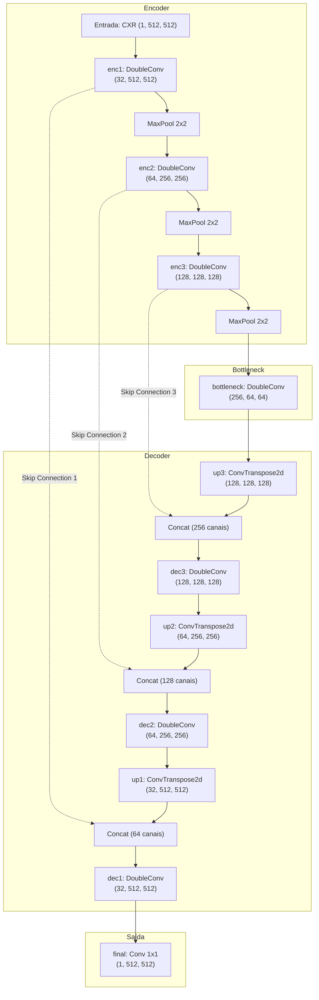

# Módulo 04: U-Net (Convolutional Networks for Biomedical Image Segmentation)

Arquivos relacionados:
- Arquitetura: [`models/unet.py`](/models/unet.py)
- Treinamento: [`train_unet.py`](/train_unet.py)
- Avaliação: [`evaluate_unet.py`](/evaluate_unet.py)

---

## 1. Contexto Teórico e Motivação

Publicada por Olaf Ronneberger, Philipp Fischer e Thomas Brox na conferência MICCAI em 2015, a arquitetura **U-Net** tornou-se o padrão mais influente e amplamente utilizado na história da segmentação de imagens biomédicas.

### O Problema Central que a U-Net Soluciona
Em redes convolucionais profundas clássicas, o processo de contração (*encoder*) utiliza camadas de *pooling* para reduzir a resolução espacial e aumentar o campo receptivo, capturando contexto semântico global (*"o que está na imagem"*). No entanto, para segmentar órgãos e tecidos com precisão, a rede precisa saber exatamente a localização espacial de cada contorno (*"onde está na imagem"*).

A U-Net resolve essa dicotomia através do conceito de **Conexões de Salto (*Skip Connections*)**:
- As conexões de salto transferem diretamente os mapas de características de alta resolução do caminho de contração (*encoder*) para o caminho de expansão (*decoder*).
- O decodificador concatena as características de alta resolução (detalhes espaciais finos e bordas) com as características de alta semântica (identificação da estrutura anatômica).

---

## 2. Diagrama da Arquitetura Implementada: [`UNet`](/models/unet.py#L37-L177)



---

## 3. Análise Detalhada dos Componentes

### 3.1. Bloco Básico: [`DoubleConv`](/models/unet.py#L5-L35)
O bloco fundamental repetido em todas as escalas da rede é composto por duas convoluções consecutivas de $3 \times 3$ com preenchimento (*padding=1*) e funções de ativação ReLU:

```python
class DoubleConv(nn.Module):
    def __init__(self, in_channels, out_channels):
        super().__init__()
        self.block = nn.Sequential(
            nn.Conv2d(in_channels, out_channels, kernel_size=3, padding=1),
            nn.ReLU(inplace=True),
            nn.Conv2d(out_channels, out_channels, kernel_size=3, padding=1),
            nn.ReLU(inplace=True)
        )
```
- Duas convoluções $3 \times 3$ consecutivas possuem o mesmo campo receptivo efetivo de uma convolução $5 \times 5$, porém com menor número de parâmetros e introduzindo duas não-linearidades em vez de uma.

### 3.2. Caminho de Contração (*Encoder*)
- `enc1`: $1 \to 32$ canais, dimensão $512 \times 512$.
- `enc2`: $32 \to 64$ canais, dimensão $256 \times 256$.
- `enc3`: $64 \to 128$ canais, dimensão $128 \times 128$.
- A cada nível, o `nn.MaxPool2d(2)` reduz a resolução espacial pela metade e dobra a profundidade de características.

### 3.3. Gargalo (*Bottleneck*)
- `bottleneck`: Convolução dupla de $128 \to 256$ canais operando na menor resolução espacial da rede ($64 \times 64$). Neste ponto, a rede atinge sua maior abstração semântica, capturando a topologia global da caixa torácica.

### 3.4. Caminho de Expansão (*Decoder*) e Conexões de Salto
A reconstrução espacial é realizada por camadas de convolução transposta com stride 2:
```python
d3 = self.up3(b)                     # 64x64 -> 128x128 (128 canais)
d3 = torch.cat([d3, e3], dim=1)      # Concatena com e3 (128+128 = 256 canais)
d3 = self.dec3(d3)                   # Refina para 128 canais

d2 = self.up2(d3)                    # 128x128 -> 256x256 (64 canais)
d2 = torch.cat([d2, e2], dim=1)      # Concatena com e2 (64+64 = 128 canais)
d2 = self.dec2(d2)                   # Refina para 64 canais

d1 = self.up1(d2)                    # 256x256 -> 512x512 (32 canais)
d1 = torch.cat([d1, e1], dim=1)      # Concatena com e1 (32+32 = 64 canais)
d1 = self.dec1(d1)                   # Refina para 32 canais
```

### 3.5. Camada de Saída
```python
self.final = nn.Conv2d(32, 1, kernel_size=1)
```
- Projeta os 32 canais da resolução final para um único mapa de logits $(B, 1, 512, 512)$.

---

## 4. Pipeline de Treinamento e Avaliação

### Configuração do Treinamento: [`train_unet.py`](/train_unet.py)
- **Função de Perda**: Combinação `bce_loss + dice_loss`.
- **Otimizador**: Adam com taxa de aprendizado $\eta = 10^{-3}$.
- **Tamanho do Lote (Batch Size)**: 8.
- **Épocas**: 20 épocas.
- **Data Augmentation**: Ativado no treino via [`get_train_augmentation()`](/augmentation.py#L3-L11) (flips horizontais e transformações afins).
- **Critério de Salvamento**: Salva em disco (`unet_best_bce_dice_aug.pth`) sempre que a perda de validação (`val_loss`) atinge um novo mínimo global.

### Avaliação Quantitativa e Visual: [`evaluate_unet.py`](/evaluate_unet.py)
- Carrega os pesos ótimos salvos em [`trained_models/unet_best_bce_dice_aug.pth`](/trained_models/unet_best_bce_dice_aug.pth).
- Itera sobre o conjunto de teste desacoplado (sem gradientes).
- Aplica $\sigma(z) > 0.5$ para obter as predições binárias.
- Calcula a média e desvio padrão do **Dice Score** e do **IoU (Jaccard)** sobre todas as imagens de teste.
- Gera um painel gráfico com 8 amostras de teste em três linhas:
  1. Imagem radiográfica original (CXR).
  2. Máscara de referência manual (Ground Truth).
  3. Máscara prevista pela rede (Prediction).
