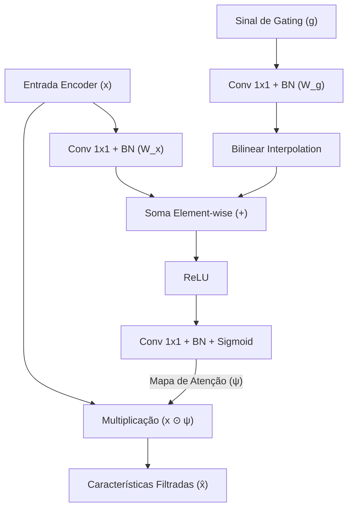
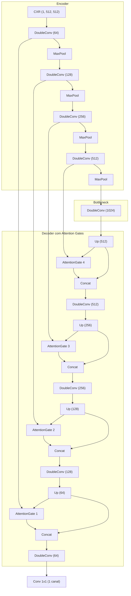

# Módulo 06: Attention U-Net (Learning Where to Look for the Pancreas/Lungs)

Arquivos relacionados:
- Arquitetura: [`models/attention_unet.py`](/models/attention_unet.py)
- Treinamento: [`train_attention_unet.py`](/train_attention_unet.py)
- Avaliação: [`evaluate_attention_unet.py`](/evaluate_attention_unet.py)

---

## 1. Contexto Teórico e Motivação

Publicada por Oktay et al. (MIDL 2018), a **Attention U-Net** foi desenvolvida para mitigar um problema recorrente na U-Net convencional:
- As conexões de salto padrão transferem **todas** as ativações do codificador para o decodificador, incluindo regiões irrelevantes para a tarefa clínica (como artefatos de clavícula, esterno, ar circundante fora do tórax e órgãos subdiafragmáticos).
- Isso introduz falsos positivos e ruídos nas primeiras camadas do decodificador, sobrecarregando o aprendizado com informações redundantes.

### A Solução: Portas de Atenção (*Attention Gates - AGs*)
O Attention Gate age como um filtro seletivo nas conexões de salto:
1. Utiliza as características contextuais mais profundas do decodificador como um sinal de controle (*gating signal* $g$).
2. Compara o sinal $g$ com as características espaciais detalhadas $x$ vindas do codificador.
3. Produz um mapa de coeficientes de atenção contínuos $\psi \in [0, 1]$ que **multiplica elemento a elemento** o mapa de características original $x$.
4. **Resultado**: Regiões anatômicas de interesse (os pulmões) têm suas ativações preservadas ou amplificadas, enquanto estruturas de fundo irrelevantes são atenuadas para zero.

---

## 2. Formulação Matemática do Attention Gate: [`AttentionGate`](/models/attention_unet.py#L5-L55)

O mecanismo implementado utiliza **atenção aditiva (*additive attention*)**, empiricamente superior à atenção multiplicativa em estabilidade e expressividade:

$$\alpha = \text{ReLU}\left( W_x(x) + \mathcal{I}(W_g(g)) \right)$$

$$\psi = \sigma\left( \psi_{\text{conv}}(\alpha) \right)$$

$$\hat{x} = x \odot \psi$$

Onde:
- $x \in \mathbb{R}^{C_x \times H \times W}$ é o mapa de características do codificador (alta resolução espacial).
- $g \in \mathbb{R}^{C_g \times H_g \times W_g}$ é o sinal de gating vindo da camada mais profunda do decodificador (alta semântica, menor resolução).
- $W_x$ e $W_g$ são convoluções $1 \times 1$ seguidas de `BatchNorm2d` que projetam ambos os sinais para um espaço latente compartilhado de dimensão intermediária `inter_channels`.
- $\mathcal{I}(\cdot)$ é a interpolação bilinear que redimensiona espacialmente $W_g(g)$ para coincidir com as dimensões espaciais $(H, W)$ de $W_x(x)$.
- $\psi_{\text{conv}}$ é uma convolução $1 \times 1$ seguida de `BatchNorm2d` e ativação `Sigmoid`, gerando um único canal de coeficientes de atenção $\psi \in [0, 1]^{1 \times H \times W}$.
- $\odot$ representa o produto de Hadamard (multiplicação elemento a elemento por canal).



---

## 3. Diagrama da Arquitetura Global: [`AttentionUNet`](/models/attention_unet.py#L83-L157)

A rede implementa um codificador e decodificador de 4 níveis de profundidade com canais em progressão geométrica até 1024 no gargalo:



---

## 4. Diferenciais de Implementação

### 4.1. Normalização por Lote (*Batch Normalization*)
Diferente da U-Net clássica simples, os blocos convolucionais da [`AttentionUNet`](/models/attention_unet.py#L83-L157) incorporam camadas explícitas de `nn.BatchNorm2d` após cada convolução $3 \times 3$:
```python
self.block = nn.Sequential(
    nn.Conv2d(in_channels, out_channels, kernel_size=3, padding=1),
    nn.BatchNorm2d(out_channels),
    nn.ReLU(inplace=True),
    nn.Conv2d(out_channels, out_channels, kernel_size=3, padding=1),
    nn.BatchNorm2d(out_channels),
    nn.ReLU(inplace=True)
)
```
Isso estabiliza a propagação de ativações através dos 4 níveis de atenção e acelera a convergência do modelo de alta capacidade ($~34.8$ milhões de parâmetros).

---

## 5. Treinamento e Avaliação

### Treinamento: [`train_attention_unet.py`](/train_attention_unet.py)
- **Função de Perda**: Composta `bce_loss + dice_loss`.
- **Otimizador**: Adam com learning rate $10^{-3}$.
- **Batch Size**: 8.
- **Épocas**: 15 épocas.
- **Melhor Modelo**: Salva o estado dos pesos em `attention_unet_best_bce_dice_aug.pth` ao minimizar a perda de validação.

### Avaliação: [`evaluate_attention_unet.py`](/evaluate_attention_unet.py)
- Carrega [`trained_models/attention_unet_best_bce_dice_aug.pth`](/trained_models/attention_unet_best_bce_dice_aug.pth).
- Mensura no conjunto de teste:
  - $\text{Dice Score} = \text{Média} \pm \text{Desvio Padrão}$
  - $\text{IoU Score} = \text{Média} \pm \text{Desvio Padrão}$
- Plota comparações visuais demonstrando contornos costais e diafragmáticos bem delineados, livres de ruídos na região mediastinal central.
