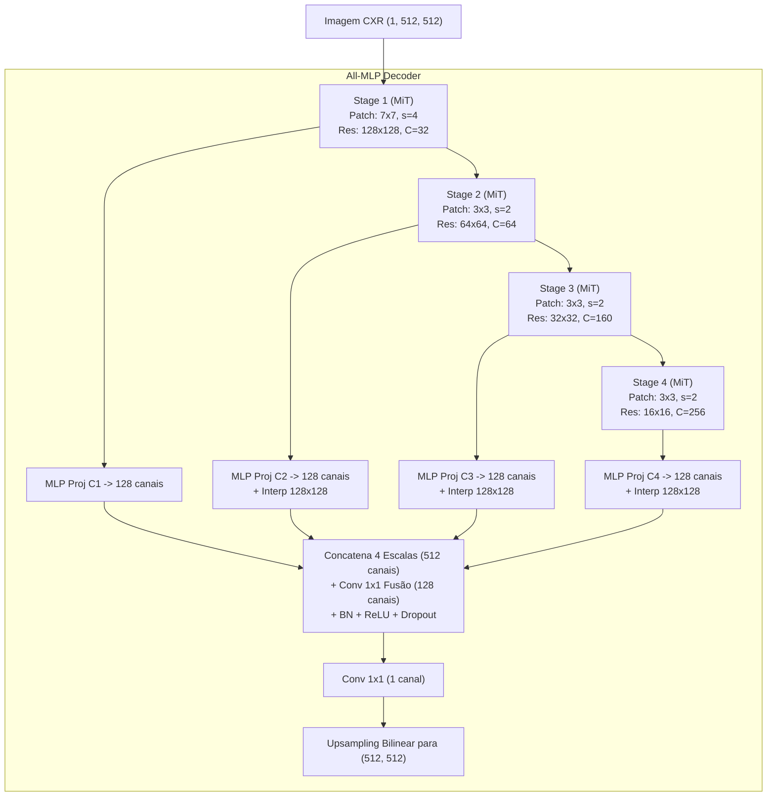

# Módulo 08: SegFormer (Simple and Efficient Design for Semantic Segmentation with Transformers)

Arquivos relacionados:
- Arquitetura: [`models/segformer.py`](/models/segformer.py)
- Treinamento: [`train_segformer.py`](/train_segformer.py)
- Avaliação: [`evaluate_segformer.py`](/evaluate_segformer.py)

---

## 1. Contexto Teórico: A Revolução dos Transformers na Visão

Enquanto as CNNs convencionais (como FCN e U-Net) são fundamentadas em operações de convolução com campos receptivos locais, os **Vision Transformers (ViTs)** operam sob o mecanismo de **Auto-Atenção (*Self-Attention*)**, permitindo modelar interações globais de longo alcance (*long-range dependencies*) entre quaisquer pontos da imagem desde as primeiras camadas.

No entanto, aplicar o ViT clássico diretamente à segmentação semântica apresentava três grandes entraves:
1. **Complexidade Quadrática**: O mecanismo de auto-atenção padrão possui complexidade computacional e de memória $\mathcal{O}(N^2)$, onde $N = H \times W$. Para uma radiografia de $512 \times 512$, $N = 262.144$, tornando a computação impraticável.
2. **Saída em Escala Única**: O ViT tradicional gera mapas de características em uma única resolução fixa, perdendo a riqueza multiescala das CNNs.
3. **Rigidez de Positional Encodings**: Interpolações de resolução degradam os pesos de codificação posicional fixa.

### A Solução do SegFormer (Xie et al., NeurIPS 2021)
O SegFormer introduz um codificador hierárquico baseado em Transformers (**Mix Transformer - MiT**) acoplado a um decodificador ultraleve composto exclusivamente por camadas lineares e convoluções $1 \times 1$ (**All-MLP Decoder**).

---

## 2. Diagrama da Arquitetura SegFormer



---

## 3. Análise Detalhada das Inovações em Código

### 3.1. Overlapping Patch Embedding: [`OverlapPatchEmbedding`](/models/segformer.py#L5-L29)
Diferente do ViT padrão que divide a imagem em patches sem sobreposição (causando descontinuidade e perda de detalhes nas bordas dos blocos), o SegFormer utiliza convoluções com sobreposição (*stride < kernel_size*):
```python
self.proj = nn.Conv2d(
    in_channels, embed_dim,
    kernel_size=kernel_size, stride=stride, padding=padding
)
```
- No Estágio 1: Kernel $7 \times 7$ com stride 4 e padding 3 preserva continuidade espacial local entre os tokens e reduz a imagem de $512 \times 512$ para $128 \times 128$.
- Nos Estágios 2 a 4: Convoluções $3 \times 3$ com stride 2 e padding 1 realizam a redução hierárquica contínua.

### 3.2. Efficient Self-Attention com Redução Espacial: [`EfficientSelfAttention`](/models/segformer.py#L30-L143)
Para resolver a complexidade $\mathcal{O}(N^2)$, o SegFormer reduz a dimensionalidade espacial das matrizes de Chaves ($K$) e Valores ($V$) através do parâmetro `sr_ratio` ($R$):
```python
if sr_ratio > 1:
    self.sr = nn.Conv2d(dim, dim, kernel_size=sr_ratio, stride=sr_ratio)
    self.norm = nn.LayerNorm(dim)
```
- As Consultas ($Q$) mantêm a resolução total $N = H \times W$.
- As Chaves ($K$) e Valores ($V$) são reduzidos por uma convolução com stride $R$, passando a ter dimensão $\frac{N}{R^2}$.
- **Impacto**: A complexidade do cálculo da atenção é reduzida de $\mathcal{O}(N^2)$ para $\mathcal{O}\left( \frac{N^2}{R^2} \right)$.
  - No Estágio 1 ($128 \times 128$), $R = 8$, reduzindo a carga computacional em **$64\times$**!

### 3.3. Mix-FFN (Eliminação dos Positional Encodings): [`MixFFN`](/models/segformer.py#L144-L195)
Em vez de somar vetores posicionais estáticos que falham se a resolução mudar durante o teste, o SegFormer introduz uma convolução de profundidade (*Depthwise Conv $3 \times 3$*) dentro da própria rede Feed-Forward:

$$\text{MixFFN}(x) = \text{Linear}_2\left( \text{GELU}\left( \text{DWConv}_{3\times3}\left( \text{Linear}_1(x) \right) \right) \right) + x$$

- Convoluções com padding naturalmente vazam pistas de localização espacial absoluta para a rede a partir das bordas preenchidas com zeros (*zero-padding*).
- O modelo torna-se agnóstico à resolução da imagem de entrada.

### 3.4. Decodificador All-MLP: [`MLPDecoder`](/models/segformer.py#L370-L480)
Diferente das CNNs que usam decodificadores complexos e pesados com convoluções transpostas, o SegFormer utiliza um decodificador minimalista:
1. Projeta os canais das 4 escalas ($[32, 64, 160, 256]$) para um valor uniforme de $128$ canais via projeção linear pontual.
2. Faz o upsampling das escalas mais profundas para a resolução de referência do Estágio 1 ($128 \times 128$).
3. Concatena as 4 escalas ($128 \times 4 = 512$ canais) e aplica uma convolução $1 \times 1$ de fusão com `Dropout2d(0.1)`.
4. Uma convolução $1 \times 1$ final gera o mapa de classes, seguido de interpolação bilinear direta para $512 \times 512$.

---

## 4. Particularidades de Treinamento e Memória

No arquivo [`train_segformer.py`](/train_segformer.py):
- **Tamanho do Lote Reduzido (`BATCH_SIZE = 2`)**:
  - Mesmo com a redução espacial (`sr_ratio`), calcular a atenção matricial de múltiplos cabeçotes em tensores de $512 \times 512$ exige considerável memória VRAM da GPU.
  - Para garantir estabilidade e evitar erros de `CUDA out of memory`, o lote é fixado em 2 amostras.
- **Função de Perda**: Combinação `bce_loss + dice_loss`.
- **Checkpoint Salvo**: `SegFormer_best_bce_dice_aug.pth`.
- **Avaliação**: O script [`evaluate_segformer.py`](/evaluate_segformer.py) roda a inferência com `BATCH_SIZE = 2`, mensurando Dice e IoU em todo o conjunto de teste.
